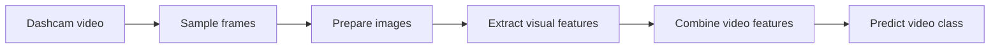
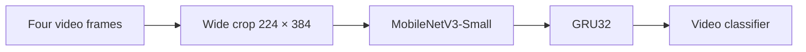

# Nexar Dashcam Crash Prediction

**Can a model recognize a dangerous driving situation from a short dashcam video?**

This project explores video classification for collision and near-miss prediction using the [Nexar Collision Prediction Dataset](https://huggingface.co/datasets/nexar-ai/nexar_collision_prediction). We start with a simple frame-based baseline, investigate video and temporal models, and present a compact MobileNetV3 + GRU candidate alongside a teammate's MobileNetV2 + BiGRU experiment.

> **Project status:** research experiments for team comparison. The selected MobileNetV3 + GRU checkpoint is a presentation candidate, not a verified final team model or a production safety system.

## Project at a glance

| | |
|---|---|
| **Task** | Video-level binary classification |
| **Positive** | Collision or near-miss |
| **Negative** | Normal driving |
| **Training / validation** | 1,200 / 300 videos from the 1,500-video development dataset |
| **Public test** | 667 videos |
| **Selected candidate** | MobileNetV3-Small + GRU32, wide crop |
| **Tools** | PyTorch, TensorFlow / Keras, OpenCV, Jupyter |

The development split is made at the **video level**: frames from one video stay in the same partition. The original training dataset contains 750 positive and 750 negative videos. The public test contains 334 positive and 333 negative videos.

## From frames to video predictions

Our first sampling experiments compared **1, 2, and 4 FPS** on 10 videos. At 2 FPS, we extracted **760 frames**, or **76 per video** on average. We chose 2 FPS as a starting point for the baseline; this check alone does not establish the best rate for model performance. In a later 100-video sampling run, 2 FPS produced 7,572 frames.

The sampling notebook saves original-size JPEG frames and a CSV for each video, recording its ID, frame index, timestamp, path, and label. The current baseline reads selected frames directly from video rather than saving JPEGs during training.

## Experiment journey

### 1. ResNet18 baseline

We sample frames at 2 FPS, preserve aspect ratio with padding to 224 × 224, and use a frozen ImageNet-pretrained **ResNet18** to extract 512 features per frame. The frame features are averaged into a single video vector, then a linear classifier predicts the class.

This gives us a simple reference, but averaging does not explicitly model the order of frames. The selected baseline uses 100 training epochs and a decision threshold of 0.45, selected on validation.

### 2. Video and temporal experiments

- **VideoMAE:** A corrected two-second experiment reached **69.00% validation accuracy**. We also explored clip lengths and temporal heads; some runs showed signs of overfitting and longer training times.
- **R(2+1)D-18:** A temporal-jitter experiment reached **69.67% validation accuracy** and **72.00% positive-class F1**. Several runs showed a large gap between training and validation performance.
- **ResNet18 + GRU64:** A 16-frame temporal experiment reached **67.67% validation accuracy** and **71.39% positive-class F1**. Its later training behavior also showed a train–validation gap.

These are selected recorded experiments, not a claim that every run of an architecture behaved the same way. The full configurations and results are in the [experiment report](docs/experiment-report.md).

### 3. Teammate experiment: MobileNetV2 + BiGRU

The teammate's [training notebook](advanced_tasks/model_training.ipynb) uses 16-frame sequences, MobileNetV2 frame features, a bidirectional GRU, and a binary classifier. It records an initial training stage followed by fine-tuning, with image augmentation during training.

The saved notebook output reports **84.33% validation accuracy** for the selected fine-tuned model and **65.97% public-test accuracy** at a 0.70 threshold. These are reported notebook results; its validation manifests and preprocessing have not been verified as identical to the other experiments.

### 4. Selected candidate: MobileNetV3-Small + GRU32

The selected wide-crop model extracts features from **four chronological frames** with MobileNetV3-Small, then uses a **GRU with 32 hidden units** and a classifier to predict the video class. It uses a 224 × 384 crop to retain more horizontal context.

The temporal head is trained first; the final two encoder blocks are then fine-tuned. The recorded candidate uses **seed 42, epoch 7**, with no EMA. It was selected using validation positive-class F1, with validation loss as a tie-breaker.

## Recorded results

Accuracy and positive-class F1 measure different things. A dash means the result was not recorded in the available experiment evidence.

| Model / recorded run | Validation accuracy | Validation positive F1 | Public test accuracy | Public test positive F1 |
|---|---:|---:|---:|---:|
| ResNet18 baseline, threshold 0.45 | 69.00% | 69.90% | 65.82% | 66.17% |
| VideoMAE, corrected two-second run | 69.00% | 67.14% | — | — |
| R(2+1)D-18, temporal jitter | 69.67% | 72.00% | — | — |
| Teammate: MobileNetV2 + BiGRU | 84.33% | — | 65.97% | 67.43% |
| **Selected: MobileNetV3 + GRU, wide crop** | **75.00%** | **75.25%** | **68.97%** | **69.87%** |

The teammate's public metrics use threshold **0.70**; the selected wide model uses **argmax**. Preprocessing, sampling, checkpoint selection, and possibly validation manifests differ between experiments, so this table is a record of results rather than a controlled comparison of architectures.

The earlier **square-crop MobileNet + GRU** reference achieved **72.33% validation accuracy**, **72.61% validation positive F1**, and **70.80% public positive F1**. The selected wide model improved validation F1 but did **not** improve public F1 over that reference. The private test set has not been evaluated for the selected model.

## Try the selected model

The saved checkpoint is included in [`NexarCrashPrediction/model/`](NexarCrashPrediction/model/). The dataset itself is distributed separately.

1. Open [`advanced_tasks/MobileNetV3_GRU_Wide.ipynb`](advanced_tasks/MobileNetV3_GRU_Wide.ipynb) in Jupyter or VS Code with a compatible Python kernel.
2. Run the notebook cells in order. With `VIDEO_PATH = None`, it loads the checkpoint, checks file hashes, and displays recorded metrics and training history without processing videos.
3. To try a single video, set `VIDEO_PATH` in the notebook to the video file and run the prediction cell. The model samples four frames from the video's final 1.5 seconds; it does not need a class label or event timestamp at inference.

The recorded environment used Python 3.10, PyTorch 2.5.1, torchvision 0.20.1, NumPy 1.26.4, OpenCV 4.8.1, Matplotlib 3.10.9, and CUDA 12.4. CPU loading is also supported. An environment file is not included; see the [model package README](NexarCrashPrediction/README.md) for details.

> The selected notebook is for loading the saved model, showing recorded results, and optional single-video inference. It does not start model training or reproduce the full experiment automatically. The teammate notebook uses a separate TensorFlow / Colab workflow and its own external inputs.

## Repository guide

| Path | Contents |
|---|---|
| [`src/Sampling.ipynb`](src/Sampling.ipynb) | Fixed-interval sampling and frame inspection |
| [`src/DataSplit.ipynb`](src/DataSplit.ipynb) and [`src/video_split.csv`](src/video_split.csv) | Development split and video IDs |
| [`src/Baseline.ipynb`](src/Baseline.ipynb) | Frozen ResNet18 baseline |
| [`advanced_tasks/model_training.ipynb`](advanced_tasks/model_training.ipynb) | Teammate's MobileNetV2 + BiGRU experiment |
| [`advanced_tasks/MobileNetV3_GRU_Wide.ipynb`](advanced_tasks/MobileNetV3_GRU_Wide.ipynb) | Selected checkpoint, recorded curves, and optional inference |
| [`NexarCrashPrediction/`](NexarCrashPrediction/) | Model pipeline, weights, metadata, and recorded results |
| [`docs/experiment-report.md`](docs/experiment-report.md) | Full experiment history, metrics, and limitations |
| [`docs/experiments-overview.md`](docs/experiments-overview.md) | Early sampling and baseline experiments |

## Limitations and next steps

- **Different sampling at development and inference:** for the selected wide model, positive development videos use frames before the annotated event, while negative development videos use frames near the end. Public-test inference uses end-of-video sampling for both classes. This class-dependent development sampling and endpoint mismatch may affect generalization.
- **Validation and public test serve different roles:** the selected model and its settings were chosen using development evidence. Public-test results have been inspected for comparisons, and the private test remains unevaluated for the selected candidate.
- **Not every positive frame shows a collision:** labels are at video level, and the positive class includes near-misses. A video-level prediction does not identify the event time.
- **Additional validation is needed:** future work can investigate consistent input sampling, temporal modeling, robustness, and performance on unseen data. An accuracy or F1 target is not guaranteed.

## Dataset and attribution

Videos are not included in this repository. Obtain the dataset separately and review its access terms and [Nexar Open Data License](https://huggingface.co/datasets/nexar-ai/nexar_collision_prediction/blob/main/LICENSE).

Moura, D. C., Zhu, S., and Zvitia, O. *Nexar Dashcam Collision Prediction Dataset and Challenge*. CVPR Workshops, 2025. [Paper](https://arxiv.org/abs/2503.03848).
